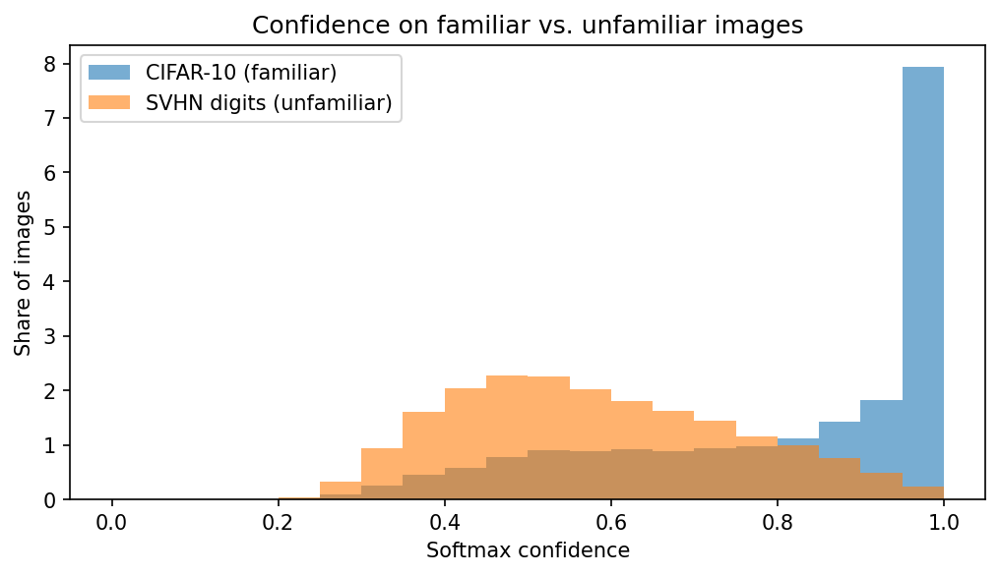
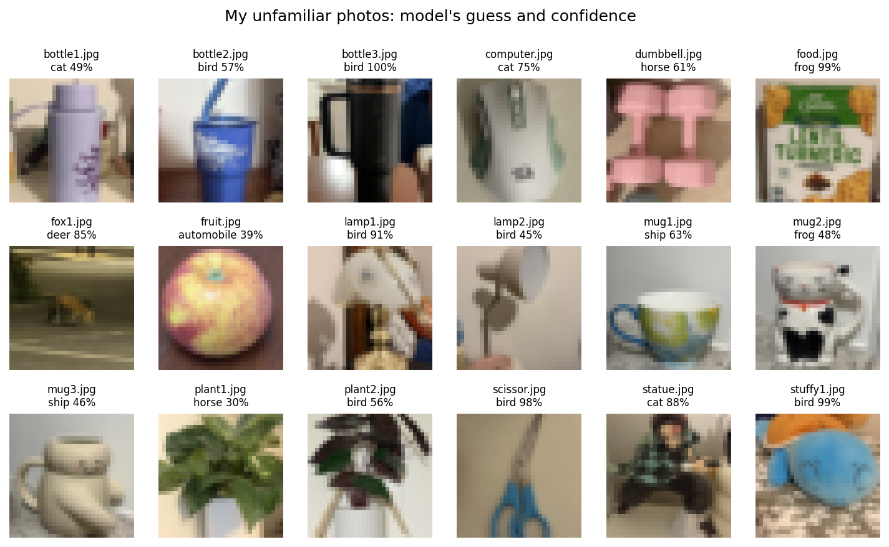
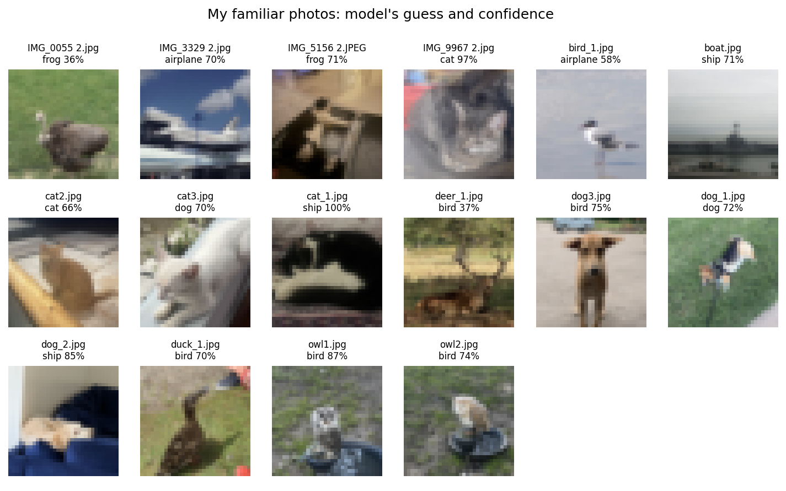

# Teaching a Vision Model to Say "I Don't Know"

**Can an image classifier tell when it's looking at something it was never trained on? I tested this on a benchmark and on my own phone photos. The answer changed a lot between the two.**

---

## The question

Image classifiers can only answer with the classes they were trained on. Shown something completely new, they still pick a class, often with high confidence. A model trained on animals and vehicles might call a cereal box a "frog" and be 99% sure.

This problem is called **out-of-distribution (OOD) detection**. The simplest fix is to say "I don't know" whenever the model's confidence is low. I wanted to find out:

1. How well does low confidence flag unfamiliar images?
2. Does a published improvement, the **energy score** ([Liu et al., NeurIPS 2020](https://arxiv.org/abs/2010.03759)), do better?
3. Do the answers hold up on real photos I took myself, not just on a benchmark dataset?

## What I did

1. **Trained a small CNN** (545,098 parameters) on [CIFAR-10](https://www.cs.toronto.edu/~kriz/cifar.html): 10 classes (airplane, automobile, bird, cat, deer, dog, frog, horse, ship, truck), 10 epochs, Adam (learning rate 0.001), batch size 64, seed 42. Test accuracy: **72.1%**.
2. **Showed it unfamiliar images:** 26,032 house-number digits from [SVHN](http://ufldl.stanford.edu/housenumbers/), the standard "unfamiliar" set paired with CIFAR-10.
3. **Compared two ways of reading the model's output** without retraining:
   - **Softmax confidence:** the top class probability (the standard baseline from [Hendrycks & Gimpel, 2017](https://arxiv.org/abs/1610.02136)).
   - **Energy score:** `logsumexp` of the raw scores, which keeps how strong the raw scores are (softmax throws that away).
4. **Checked consistency** by retraining the model with 5 different random seeds.
5. **Tested on my own photos:** 16 photos of CIFAR-10 classes (cats, dogs, birds, an airplane, a boat, a deer) and 18 everyday objects (mugs, bottles, plants, scissors, a stuffed toy, a baby fox), mostly taken on my phone.

Both methods are scored with the two standard OOD measures:
- **AUROC** (higher is better): pick one random familiar image and one random unfamiliar image; how often does the familiar one get the higher score? 50% is a coin flip, 100% is perfect.
- **FPR95** (lower is better): set the cutoff so 95% of familiar images still get answered; what share of unfamiliar images slip through?

## Results

| Test | Softmax AUROC ↑ | Energy AUROC ↑ | Softmax FPR95 ↓ | Energy FPR95 ↓ |
|---|---|---|---|---|
| SVHN digits (seed 42) | 80.5% | 78.7% | 81.6% | 92.9% |
| SVHN digits (5 runs, avg ± spread) | 79.9% ± 1.3 | 81.2% ± 2.6 | 81.6% ± 2.6 | 88.6% ± 4.7 |
| My phone photos (seed 42) | 54.2% | 62.8% | 94.4% | 61.1% |



*Confidence on familiar CIFAR-10 images piles up near 100%. Unfamiliar SVHN digits spread around 40–60%, but with a tail that overlaps the familiar images.*

## Key findings

### 1. Low confidence is a useful but weak "I don't know" signal

On the benchmark, the model was less confident on unfamiliar digits (average 58.2%) than on familiar images (81.1%), and softmax reached about 80% AUROC. But the two groups overlap, so every cutoff is a trade-off:

| Cutoff | Unfamiliar digits caught | Familiar images wrongly rejected |
|---|---|---|
| 50% | 36.1% | 10.8% |
| 70% | 74.6% | 28.8% |
| 90% | 96.3% | 51.2% |

Catching almost all digits means refusing about half of the real images. And 3.7% of digits got over 90% confidence, so no sensible cutoff can catch them.

### 2. The energy score did not reliably beat softmax on a small model

In my first (unseeded) run, energy beat softmax (81.1% vs 78.4% AUROC). In the seeded run, it lost (78.7% vs 80.5%). To settle it, I retrained 5 times:

- **AUROC:** energy won 4 of 5 runs, but by only 1.3 points on average, about half of its own spread.
- **FPR95:** energy was **worse in all 5 runs** (88.6% vs 81.6%).
- **Stability:** energy's results varied about twice as much as softmax's.

The paper's gains were reported on larger, better-trained models. With this small CNN, the improvement didn't hold up, and a single run would have given a misleading answer.

### 3. On real photos, both methods were close to chance

On my own photos, the model recognized only 8 of 16 familiar photos (vs 72.1% on CIFAR-10 test images), and unfamiliar objects got about the same confidence as familiar ones (68.2% vs 71.1%). Both methods were near chance: AUROC ranged from 46% to 63% across two trained models.

Many everyday objects were **confidently wrong**:

| My photo | Model's guess | Confidence |
|---|---|---|
| black travel tumbler | bird | 100% |
| cereal box | frog | 99% |
| blue stuffed toy | bird | 99% |
| scissors | bird | 98% |
| baby fox (not a CIFAR-10 class) | deer | 85% |

A likely reason is **domain shift**: close-up, indoor phone photos look very different from CIFAR-10's small web images, so the model is unsure about real cats and dogs too, and their confidence sinks to the level of the unfamiliar objects. The guesses also seem driven by color (green box → frog, blue objects → bird or ship).





**Main takeaway:** a method that looks reasonable on a benchmark can fall to chance on real photos. Benchmark scores alone overstate how well a model knows what it doesn't know.

## Limitations

- **Small model, no data augmentation.** Published OOD results use much larger networks; my conclusions apply to small models.
- **Only 34 personal photos.** Enough to show the pattern, not enough to rank methods; the photo scores moved a lot between two trained models.
- **One benchmark pair.** I only used SVHN as the unfamiliar set.
- **Photo scores come from two models,** not the full 5-run check.

## Next steps

- Repeat with a larger model (for example a ResNet) to see whether the energy score's advantage appears as model quality improves.
- Collect more real photos and run them through all 5 seeds.
- Add other unfamiliar datasets (for example CIFAR-100 or texture images).
- Try other detection methods, such as ODIN or Mahalanobis distance.
- Study the domain-shift effect directly: does fine-tuning on a few phone photos restore the gap between familiar and unfamiliar confidence?

## How to run

1. Open [`ood_detection.ipynb`](ood_detection.ipynb) in Google Colab.
2. Turn on a GPU: **Runtime → Change runtime type → T4 GPU**.
3. Create a folder `ood_project/my_photos/` in your Google Drive with two subfolders, `familiar/` and `unfamiliar/`, and add photos. You can copy the ones in this repo's [`my_photos/`](my_photos) folder, or use your own (or edit `PROJECT_DIR` in the setup cell).
4. **Runtime → Run all**, and allow Google Drive access when asked.

The first run trains the main model (about 3 minutes on a T4) and the 5-seed check (about 15 minutes); both are saved to Drive, so later runs load them in seconds. Seeds are fixed, so results are reproducible.

## Repository contents

```
ood_detection.ipynb      the full experiment, top to bottom
figures/                 charts used in this README
my_photos/               my 34 test photos (familiar/ and unfamiliar/)
```

## References

- Hendrycks, D. & Gimpel, K. (2017). *A Baseline for Detecting Misclassified and Out-of-Distribution Examples in Neural Networks.* ICLR.
- Liu, W., Wang, X., Owens, J. & Li, Y. (2020). *Energy-based Out-of-distribution Detection.* NeurIPS.
- Krizhevsky, A. (2009). *Learning Multiple Layers of Features from Tiny Images* (CIFAR-10).
- Netzer, Y. et al. (2011). *Reading Digits in Natural Images with Unsupervised Feature Learning* (SVHN).
